# FT Combined

`ft.hpp` merges the FT family behind one immediate-mode API:

- `ftui.hpp`: native GUI backend
- `ftti.hpp`: terminal TUI backend
- `ftht.hpp`: embedded web UI backend

The public syntax follows FTUI:

```cpp
#define FT_IMPLEMENTATION
#include "ft.hpp"

int main(int argc, char** argv) {
    ft::Config cfg;
    cfg.title = "Combined FT App";
    cfg.mode = ft::Mode::Auto;

    if (!ft::create_window(cfg, argc, argv)) return 1;

    char name[64] = "";
    bool enabled = true;

    while (ft::pump()) {
        ft::begin();
        ft::text("Hello from ft.hpp");
        ft::input("Name", name, sizeof(name));
        ft::checkbox("Enabled", &enabled);
        if (ft::button("Run")) ft::toast_success("Run clicked");
        ft::end();
    }

    ft::shutdown();
    return 0;
}
```

## Modes

`cfg.mode = ft::Mode::Auto` chooses a backend at launch:

- GUI when a normal desktop display is available
- TUI when running on a real terminal without a display
- web server when neither GUI nor TUI is available

Command-line flags override `cfg.mode`:

- `--ft-auto`
- `--ft-gui` or `--gui`
- `--ft-tui` or `--tui`
- `--ft-web` or `--web`
- `--ft-mode=auto|gui|tui|web`

Forced modes do not fallback. Auto mode tries its best fallback path if the first backend cannot open.

## GUI To Web Handoff

Apps launched through `ft::create_window()` can expose the same immediate-mode UI over HTTP while keeping a tiny local control window:

```cpp
ft::webserver_button();
```

When clicked from GUI mode, FT starts the FTHT server using the `web_*` fields from `ft::Config`, shrinks the native window to a small stop-control view, and serves browser requests through the same `ft::` widget calls. The stop-control window only shows the server URL and a stop button.

If the app does not include `ft::webserver_button()`, the built-in command line can do the same thing:

- `:webserver`
- `:web`
- `:server`
- `:ws`

## Build

Linux:

```bash
c++ examples/ft_combined_smoke.cpp -o build/ft_combined_smoke -std=c++17 $(pkg-config --cflags --libs cairo x11) -pthread
```

Build every bundled demo:

```bash
sh scripts/build_demos.sh
```

Bundled demos:

- `examples/ftui/showcase.cpp`
- `examples/ftui/control_panel.cpp`
- `examples/ftui/log_viewer.cpp`
- `examples/ftui/benchmark.cpp`
- `examples/ftui/navigation_status.cpp`
- `examples/ftht/http_showcase.cpp`
- `examples/ftht/device_panel.cpp`
- `examples/ftht/login_form_demo.cpp`
- `examples/ftht/login_draw_demo.cpp`
- `examples/ftht/compile_overwatch.cpp`

The FTHT demos are intentionally written against `ft::`, not direct `ftht::`, so opening the built executables normally on a desktop starts the FTUI GUI. Use `--ft-web` when you want the same demo to launch directly as an embedded web panel.

Windows with MSVC:

```bat
cl /std:c++17 examples\ft_combined_smoke.cpp d2d1.lib dwrite.lib gdi32.lib ole32.lib uuid.lib user32.lib windowscodecs.lib ws2_32.lib
```

## Screenshots

### Native GUI

| Showcase overview | Drawer and progress masks |
| --- | --- |
| 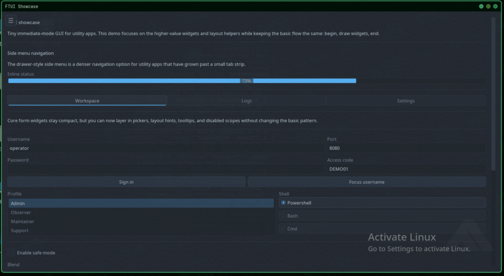 | 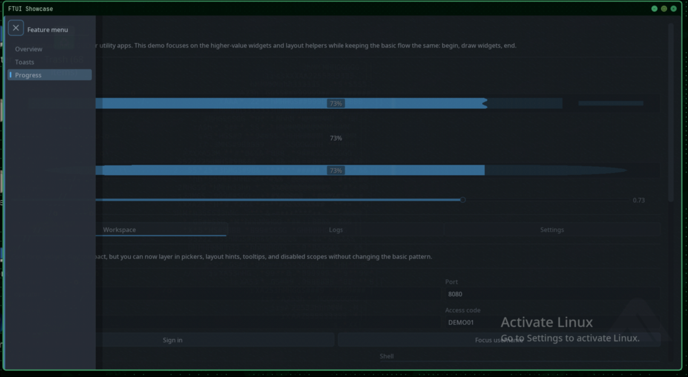 |

| Controls and colors | Ghostty-style theme and toasts |
| --- | --- |
| 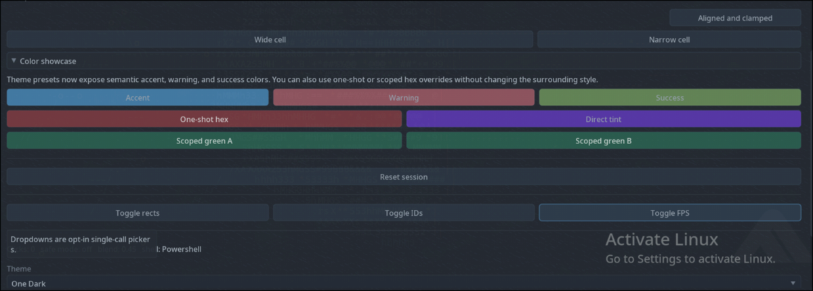 | 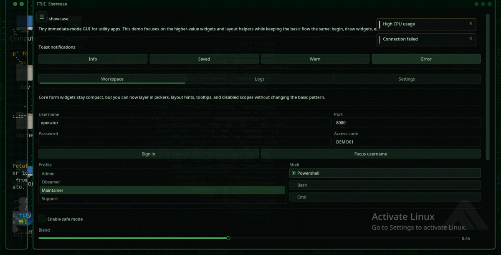 |

### Terminal TUI

| Dashboard | Inputs | Themes |
| --- | --- | --- |
| 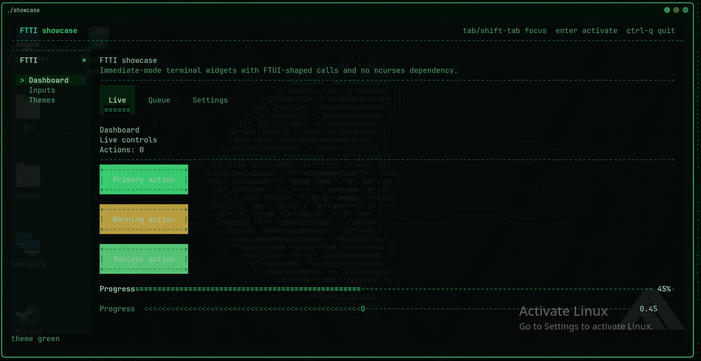 | 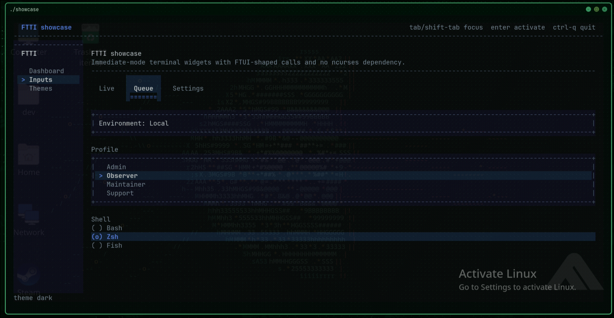 | 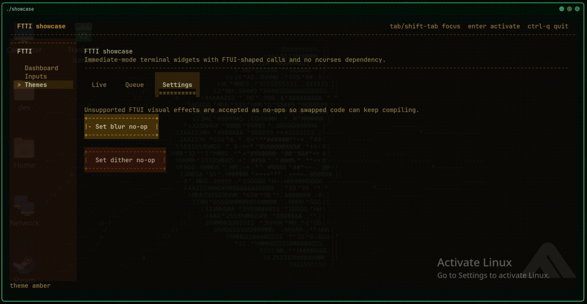 |

### Embedded Web

| Status | Controls |
| --- | --- |
| 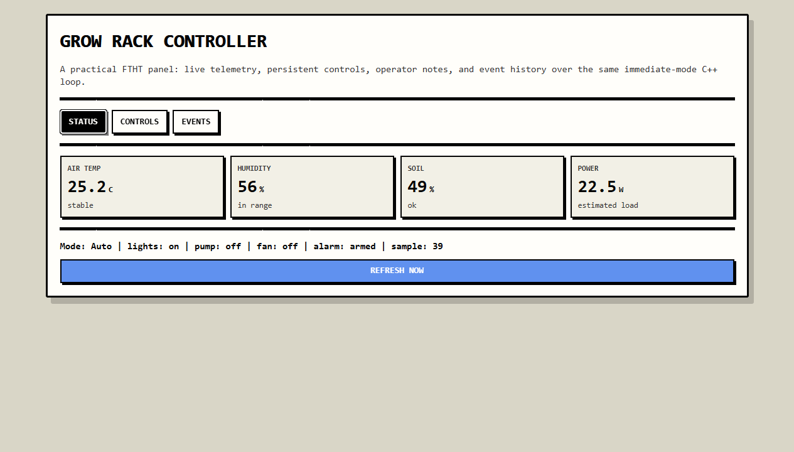 | 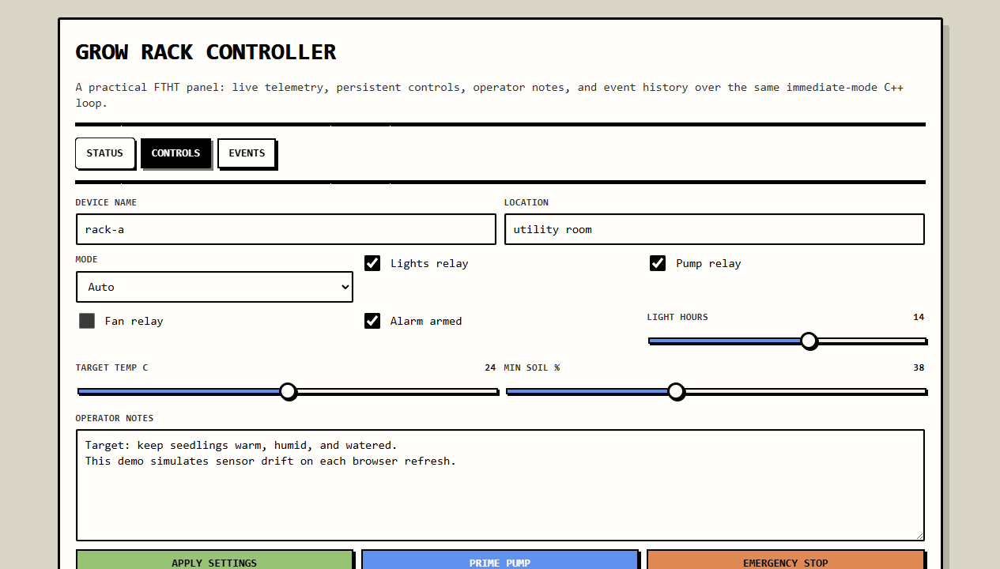 |

| Slider | Event log |
| --- | --- |
| 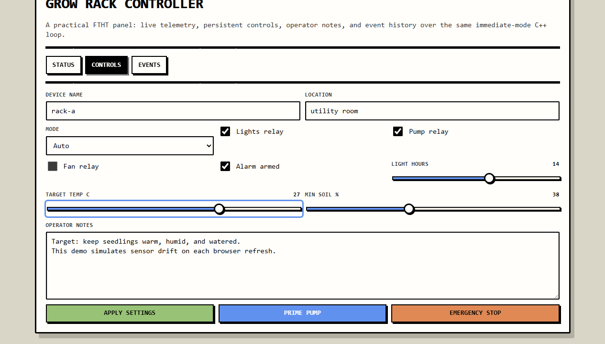 | 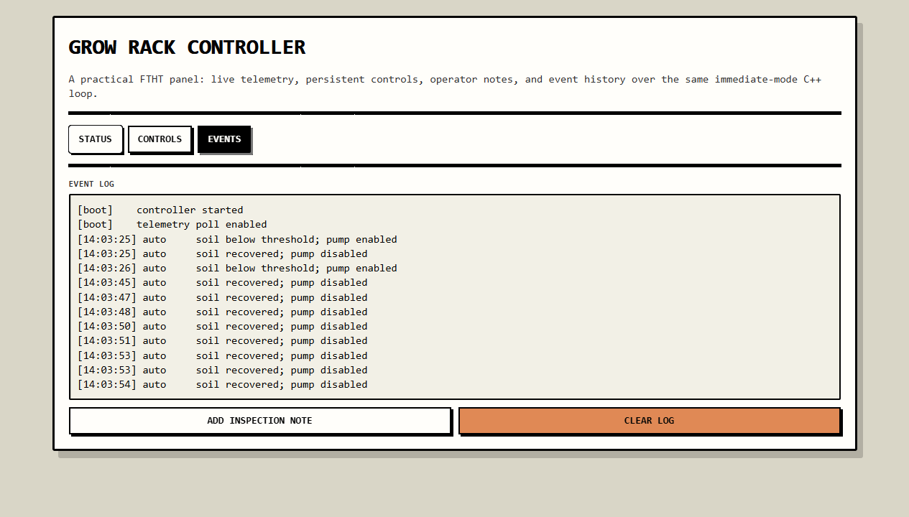 |

## Backend Escape Hatches

Use `ft::` for portable FTUI-style code. The original namespaces still exist:

- `ftui::` for native-only features
- `ftti::` for terminal-only features
- `ftht::` for server/request-specific features

`ft::html()`, `ft::url()`, `ft::path()`, `ft::method()`, `ft::param()`, and `ft::set_status()` are web-only helpers that become harmless no-ops or empty values outside web mode.
