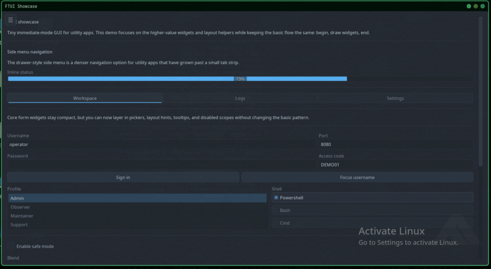
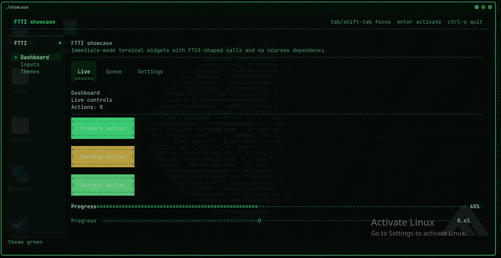
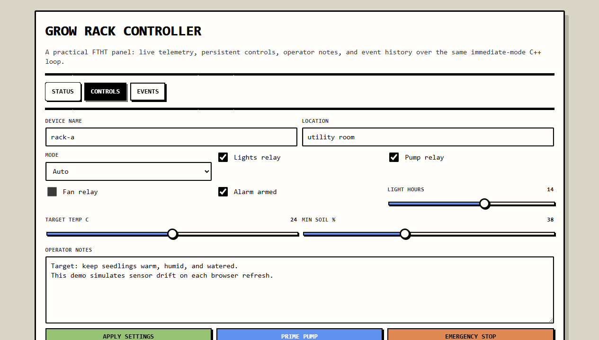

# Backends and portability

[Documentation home](index.md) · [Web integration](web.md)

## Feature matrix

| Feature | GUI / FTUI | TUI / FTTI | Web / FTHT |
| --- | --- | --- | --- |
| Basic controls | Native drawing | Terminal cells | HTML form controls |
| Explicit dimensions | Pixels | Cells/rows | CSS pixels |
| Weighted rows | Supported | Supported | CSS grid |
| Sidebar drawer | Drawer | Side menu fallback | Radio-group menu fallback |
| `side_layout` / `content` | Layout scopes | Layout scopes | Callbacks only |
| Collapsing header | Interactive | Interactive | Static heading and state check |
| Focus request | Supported | Supported | No-op |
| Tooltip | Local help | Terminal help | Inline small text |
| Context menu | Spatial popup | Action list | Browser popup |
| Table navigation | Scroll and keyboard | Pagination | Pagination |
| Images | Platform decoder | Terminal support/placeholder | Facade no-op |
| File dialog | Native/platform helper | Empty result | Empty result |
| Child window | Native | Inline callback | Inline callback |
| Clipboard | OS text clipboard | Callback; opt-in OSC 52 write | Browser viewer; callback for synchronous facade calls |
| Progress effects | Rich rendering | Simplified | Progress and label |
| Frame pacing | Local FPS limit | Local FPS limit | Request-driven; client polling |
| `ft::debug()` | Live GUI state | Facade fallback state | Facade fallback state |

See [custom graphics and overlays](graphics.md) for canvas/result-list APIs,
independent HUD windows, shader availability and the Linux/Windows distinction.

## Native platform details

Windows uses Direct2D/DirectWrite and platform windowing APIs. Linux uses X11/Cairo. Blur effects are Windows-specific; dither support is broader. Window opacity/transparency also depends on the desktop compositor. A runtime flag cannot make unsupported platform effects available.

Every native FT window receives the built-in FT icon by default. Linux publishes 32, 64, 128 and 256-pixel ARGB variants through `_NET_WM_ICON`; Windows uses its native icon handles. `set_window_icon_builtin()` supports `Symbol` and `SymbolWithText` on both platforms. `set_window_icon()` / `Config::icon` accept Windows HICON handles; Linux apps can replace `_NET_WM_ICON` with their app-specific icon after creation, as SoyScope does. Theme changes preserve the current icon. `WindowTransparency` includes `Opaque`, `Plain`, `BayerDither`, and `Blur`; `BackdropEffect` includes `Blur` and `BayerDither`.

## Terminal behavior

Use an interactive terminal. On Unix, both stdin and stdout must be terminals. On Windows, forced TUI mode can provide a dedicated console for a GUI-subsystem application. Configurable options include alternate-screen use, mouse reporting, Ctrl+Q quitting, and animation.

Wheel handling relies on terminal mouse reporting. Widget-local scrolling handles events over scrollable widgets; page scrolling handles the rest. Terminal capability affects image display, colors, clipboard escape handling, and available input events.

At facade creation a non-positive FPS limit maps to 30 for TUI, unlike uncapped native rendering. Do not assume every configuration value has identical meaning on both backends.

## Direct backend APIs

Use `ftui::create_window()` for GUI-only applications, `ftti::create_window()` for terminal-only applications, or `ftht::create_server()` for HTTP-only applications. Each has its own `Config`, `Style`, types, and lifecycle. Direct creation does not initialize facade routing and does not parse facade mode flags; use the same namespace consistently through the loop.

FTTI also exposes `label()`, `animation_time()`, `terminal_width()`, `terminal_height()`, and terminal-specific style factories (`light_style`, `terminal_green_style`, `midnight_style`, `amber_style`). These are not facade functions.

FTHT exposes `pump(timeout_ms = -1)` for server polling, with zero used by the facade for handoff polling. Its config fields omit the facade's `web_` prefix; it does not use native width/height settings. A false polling result need not mean an application should exit when using a nonblocking timeout: it can mean no request is ready.

Do not pass backend types interchangeably just because their fields look similar. `ft::` aliases many FTUI types but converts styles and flags for other backends. Avoid calling `internal`/`detail` symbols from application code; they are not a supported extension interface.

## Screenshots from the bundled demos

These repository screenshots show the actual backends, complementing the browser teaching models. Theme and platform details can differ from your build.

### Native GUI

### Terminal

### Embedded web

