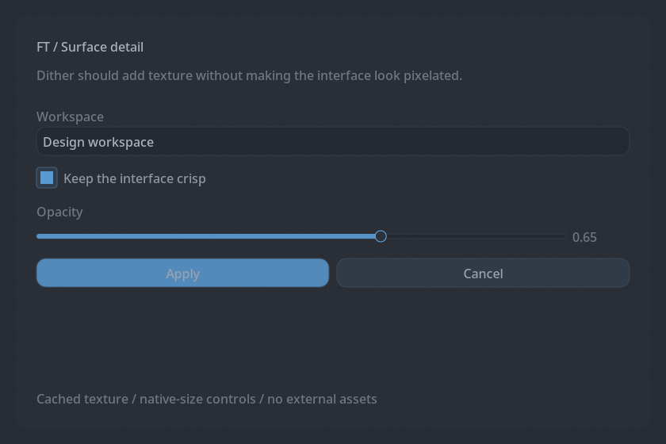

# Layout, style, and feedback

[Documentation home](index.md) · [Widgets](widgets.md)

## Layout scopes

`row(n, callback)` places controls into equal-width columns. `row({weights...}, callback)` uses relative weights. `split({weights...}, callback)` supplies a split layout; web maps it to a weighted row. Layout callbacks run synchronously during rendering.

```cpp
ft::row({2.0f, 1.0f}, [&] {
    ft::input("Search", query, sizeof(query));
    if (ft::button("Find")) { /* search */ }
});
```

`side_layout(width, callback)` establishes a sidebar layout on local backends; place the main body in `content(callback)`. Web executes these callbacks without a special sidebar container. `scroll_area(label, height, callback)` bounds scrolling content and requires a stable label.

The facade forwards explicit dimensions unchanged. GUI and web sizing is pixel-oriented; terminal sizing uses cells/rows. A 260-pixel sidebar width is not a suitable terminal width. Use portable proportional layouts or choose dimensions with backend behavior in mind. During handoff `active_mode()` still reports the original local backend, so it is not a reliable test for the current render target.

## Size the next item

| Function | Effect |
| --- | --- |
| `set_next_width(value)` | Explicit width. |
| `set_next_fill()` | Fill available width. |
| `set_next_percent(fraction)` | Fractional width, e.g. `0.5f` for half. |
| `set_next_limits(min, max)` | Width bounds. |
| `set_next_align(Align::Start/Center/End)` | Horizontal alignment. |

Apply next-item settings immediately before the intended widget. They are one-item hints, not a persistent style. `spacing()` adds vertical space; its default of 8 is passed through to terminal rows as well. `separator()` draws a divider. `calc_text_width()` and `calc_text_height()` provide backend measurements; web values are estimates, not browser layout measurements.

## Themes and colors

```cpp
ft::set_style(ft::nord_style());
ft::Style style = ft::get_style();
style.rounding = 6.0f;
style.accent = ft::color_from_hex("#88c0d0");
ft::set_style(style);
```

Factories: `default_dark_style`, `catppuccin_mocha_style`, `nord_style`, `gruvbox_dark_style`, `one_dark_style`, and `ghostty_green_style`. `style_from_name()` resolves a name through FTUI. `style_name()` and `current_style_name()` use FTUI's theme identification; direct backend changes may not match the facade's cached `get_style()` value.

`color_from_hex()` accepts `#RRGGBB` or `#RRGGBBAA`. Invalid text asserts in debug builds and returns white in release builds.

`ft::Color` stores floating-point RGBA channels; use 0–1 values. The facade converts RGB to the terminal backend's 0–255 representation. `Style` contains background/panel/text/border/control colors, accent/warning/success colors, and padding, spacing, item height, rounding, border width, and font size. Terminal style conversion scales spacing and height and removes rounding.

```cpp
ft::push_color(ft::ColorRole::Text, ft::color_from_hex("#a3be8c"));
ft::text("Connected");
ft::pop_color();
ft::set_next_color(ft::ColorRole::Border, ft::color_from_hex("#bf616a"));
ft::button("Review");
```

Balance each push with a pop in the same render path. `set_next_color()` affects the next consuming widget. Buttons also accept a `ColorRole` or explicit `Color` overload. See [API types](api.md#types) for the full set of roles and defaults.

## Modals, disabled controls, and focus

Open a modal in response to an event, then call `modal()` every frame where it may appear:

```cpp
if (ft::button("Confirm action")) ft::open_modal("Confirmation");
ft::modal("Confirmation", [&] {
    ft::text("Continue?");
    if (ft::button("Cancel")) ft::close_modal();
});
```

`modal()` returns whether it rendered its callback. Pair `begin_disabled()` and `end_disabled()` around controls that should not accept interaction. `tooltip()` attaches help to the preceding item; web renders inline help text. `request_focus(label)` targets a local widget; web's implementation is a no-op.

## Toasts and progress

`toast_info`, `toast_success`, `toast_warning`, and `toast_error` provide short messages. `toast(message)` uses the info type. For custom lifetime, pass a `Toast` with `message`, `type`, `duration_ms` (default 3500), and `dismissible` (default true). `clear_toasts()` removes queued feedback. Emit toasts on events, not on every frame.

`progress_bar(fraction)` expects normalized progress, normally 0–1. The string overload accepts a label or mask path according to backend handling. Prefer `ProgressStyle` to make intent explicit:

```cpp
ft::ProgressStyle progress;
progress.label = "Upload";
progress.fill_role = ft::ColorRole::Success;
progress.show_percent = true;
ft::progress_bar(0.6f, progress);
```

`ProgressStyle` also exposes custom fill color, height, image/SVG/shape masks, wave front, and glint. Native rendering supports the richer effects; the facade's web path forwards only progress and label. Do not depend on masks or animation for conveying essential status.

## Dither surfaces and display resolution

`BackdropEffect::BayerDither` and `WindowTransparency::BayerDither` use a cached fine-grain texture. The default motif size remains 4; `set_dither_size()` controls its distribution scale, not enlarged square bitmap pixels. The texture repeats over at least 256 logical pixels and is generated at device resolution, up to 4×, instead of magnifying a fixed 96-DPI tile. Windows uses the renderer DPI; Cairo uses the target surface's device scale. The cache refreshes when scale, motif size, or relevant colors change. Grain follows rounded panel corners.



This image is a headless render using the real Cairo drawing functions. It does not simulate compositor transparency. Use `tests/render_dither.cpp` to render the same scene at 1×, 1.5×, and 2× for visual comparisons.
